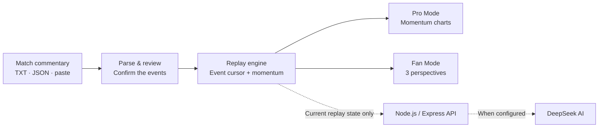

<div align="center">


# ⚽ PitchPulse · 看球牛牛

### The final score tells you who won. We show you how the match felt.

**An interactive football replay that turns written match commentary into momentum, key moments, and fan perspectives.**

**[▶ Try the live demo](https://pl-hackathon-web-bmetckfaa9e4awhg.germanywestcentral-01.azurewebsites.net/)** · **[Explore the features](#the-experience)** · **[Run locally](#run-it-locally)**

[](https://github.com/Steven-ZYC/premier-league-hackathon26/actions/workflows/azure-app-service.yml)
[](https://github.com/Steven-ZYC/premier-league-hackathon26/actions/workflows/ci.yml)


<sub>React + TypeScript · Node.js + Express · Microsoft Azure App Service · Optional DeepSeek AI</sub>

</div>

---

## ✨ Why PitchPulse?

A scoreline tells us the result, but not the story: the pressure before a goal, the sudden shift after a red card, or how the same incident feels to two different sets of supporters.

**PitchPulse turns a match's written timeline into a replay you can explore, not just read.** Pause at any event, examine each team's momentum, switch perspectives, and trace every interpretation back to the original commentary.

## 🎮 The experience

| 🟣 **Pro Mode — Follow the momentum** | 🟡 **Fan Mode — Feel the moment** |
| :--- | :--- |
| Independent momentum curves for the home and away teams | Switch between **Neutral**, **Home**, and **Away** perspectives |
| See how goals, shots, corners, and red cards affect each team | Experience different reactions to the **same event** |
| Explore turning points with time-decayed, transparent event weights | Compare commentary while keeping the original match text accessible |
| Track the unfolding match without relying on future events | Switch perspectives without losing your replay position |

**Both modes share the same match, playback cursor, play/pause state, and replay speed.** The interface supports **English, 简体中文, and 繁體中文**, including localized demo team and competition names.

### Try it in 30 seconds

1. **[Open PitchPulse](https://pl-hackathon-web-bmetckfaa9e4awhg.germanywestcentral-01.azurewebsites.net/)** and select one of the three built-in demonstration matches.
2. Switch between **Pro** and **Fan** modes, then move through the event timeline.
3. Paste commentary or upload a **TXT / JSON** file to create your own replay; review the parsed events before confirming them.

> **Demo-data note:** The three built-in matches are fictional illustrations, not historical Premier League match results.

## 🧠 What makes it different?

- **Explainable momentum, not a mystery score.** A deterministic event-weighting engine applies exponential time decay. Goals matter more than corners, and older events gradually lose influence. Both teams are evaluated independently.
- **Replay without spoilers.** At each point in the replay, calculations use only confirmed events available up to that point. Final statistics do not appear prematurely.
- **AI when useful, rules when sufficient.** With a configured DeepSeek key and Azure authentication, the server can help parse commentary, generate perspective-aware narration, and predict the direction of momentum after the next meaningful event. Basic replay and rule-based import still work without AI.
- **Humans verify the data.** Imported events can be inspected and corrected before saving. Original commentary is preserved for reference.
- **Lightweight deployment.** Vite builds the client; esbuild bundles the Express server, API, and shared logic into a prebuilt package served from one Node.js process on **Microsoft Azure App Service**.

### Under the hood



<details>
<summary><strong>📐 How is momentum calculated?</strong></summary>

PitchPulse uses a transparent **experimental index** — **not** a calibrated win probability, expected goals (`xG`), or a betting signal.

```text
M_team(t) = clamp(50 + Σ[w_team(e) × 2^(-Δactive(t,e)/3)], 0, 100)
```

The score starts at a neutral 50, considers confirmed events in the recent eight active match minutes, and uses a three-minute half-life.

| Event | Event team | Opponent |
| :--- | ---: | ---: |
| Goal | +12 | −6 |
| Shot on target (no goal) | +5 | −2 |
| Shot off target / blocked | +2 | 0 |
| Corner | +1 | 0 |
| Red card | −8 | +3 |

Special handling covers own goals, VAR reversals, linked shots/saves, stoppage time, and missing data. The implementation lives in [`shared/engine.ts`](shared/engine.ts), with regression tests in [`tests/engine.test.ts`](tests/engine.test.ts).

</details>

## 🛠️ Tech stack

| Layer | Technology | Why it matters |
| :--- | :--- | :--- |
| Frontend | **React 19 · TypeScript · Vite** | Fast, responsive replay UI |
| Replay engine | **TypeScript shared modules** | Consistent parsing, normalization, and transparent calculations |
| Backend | **Node.js 24 · Express 5** | Serves both the SPA and `/api/*` through one process |
| AI integration | **DeepSeek API (optional)** | Context-limited parsing, commentary, and momentum-direction prediction |
| Hosting | **Microsoft Azure App Service** | Existing Linux Web App, with GitHub Actions deployment |
| Automation | **GitHub Actions** | Tests, type checks, production smoke tests, and ZIP deployment |

```text
src/         React interface, playback, import, translations
shared/      Match types, parser, demos, momentum engine
api/src/     Parse / commentary / predict business logic
server/      Express production server and Azure authentication adapter
scripts/     Local development and production packaging
tests/       Engine, API, authentication, and production smoke tests
```

## 🚀 Run it locally

Requires **Node.js 24 LTS**, npm, and Git.

```bash
git clone https://github.com/Steven-ZYC/premier-league-hackathon26.git
cd premier-league-hackathon26
npm ci
npm run dev:full
```

Open **http://127.0.0.1:5173**. The local development server supplies a loopback-only API; no Azure account or DeepSeek key is required to try the core replay.

To enable optional AI locally, copy `.env.example` to `.env`, set `DEEPSEEK_API_KEY`, and restart `npm run dev:full`. Never commit your key or expose it as a `VITE_` variable.

### Validate a production build

```bash
npm test
npm run typecheck
npm run build
npm run package:appservice
npm run test:production
```

The production package is generated in `release/`. It is prebuilt and does not require installing development dependencies on the Azure worker.

## ☁️ Azure deployment

PitchPulse is deployed to an existing **Azure App Service (Linux / Node.js 24)**:

**[Launch the Azure-hosted app](https://pl-hackathon-web-bmetckfaa9e4awhg.germanywestcentral-01.azurewebsites.net/)** · **[View deployment workflow](.github/workflows/azure-app-service.yml)**

The GitHub Actions workflow runs tests, bundles the application, checks the packaged production server, and deploys the ZIP using an App Service **publish profile stored in GitHub Actions Secrets**. Pushes to `main` trigger the deployment workflow when `AZURE_APP_SERVICE_ENABLED=true`.

For configuration, authentication, security checks, and detailed Azure setup, see the **[Engineering & Deployment Guide (中文)](docs/ENGINEERING.md)**.

> **Security & cost:** Never commit `.PublishSettings`, `.env`, or API keys. Publish-profile credentials should be rotated if exposed. The actual App Service pricing tier must be checked in Azure Portal — a plan's name does not guarantee it is on the F1 free tier. DeepSeek usage may incur separate charges.

## 🔎 Transparency & limitations

- **No invented live data:** Built-in fixtures are explicitly fictional. Imported records are attributed to the user's supplied text.
- **No future-event leakage in replay AI:** The server reconstructs an event-prefix context for predictions and narration; this is covered by tests, not a claim of perfect model accuracy.
- **AI is optional:** Without a valid key or enabled authentication, paid-model features are unavailable; the core replay stays usable.
- **Browser-local storage:** Custom matches live in `localStorage`; use JSON export/import to transfer them. There is no shared match database.
- **Experimental analytics:** Momentum is a narrative/visualization aid, not a statistically calibrated forecast. AI outputs can be wrong and should be checked against the underlying commentary.

For input structure, VAR and stoppage-time edge cases, authentication boundaries, rate limits, and an end-to-end verification checklist, consult the [engineering reference](docs/ENGINEERING.md).

<details>
<summary><strong>🇨🇳 中文速览</strong></summary>

**PitchPulse（看球牛牛）** 将文字足球赛况转化为可交互的比赛回放。**专业模式**提供主客队独立势头曲线，**球迷模式**提供中立、主队、客队三种叙事视角。支持 TXT/JSON 导入、事件核对、简繁英界面切换，以及可选的 DeepSeek AI 解说与趋势预测。

项目通过 **GitHub Actions** 构建并部署到 **Microsoft Azure App Service**；动量值基于公开的事件权重和时间衰减计算，**不代表胜率**。三场内置比赛为虚构演示数据。

- **[在线体验](https://pl-hackathon-web-bmetckfaa9e4awhg.germanywestcentral-01.azurewebsites.net/)**
- **[中文技术、部署与安全文档](docs/ENGINEERING.md)**

</details>

## 🙌 Credits & disclaimer

Built for a **football hackathon** as an interactive replay prototype. Team crests are used for team identification; their respective owners retain their rights. The project uses assets sourced from [football-data.org](https://www.football-data.org/).

PitchPulse is an independent project and is **not affiliated with, endorsed by, or an official product of the Premier League or Microsoft**. Microsoft Azure is the hosting platform.

<div align="center">

**[⚽ Experience PitchPulse](https://pl-hackathon-web-bmetckfaa9e4awhg.germanywestcentral-01.azurewebsites.net/)**

<sub>Beyond the score. Into the story.</sub>

</div>
